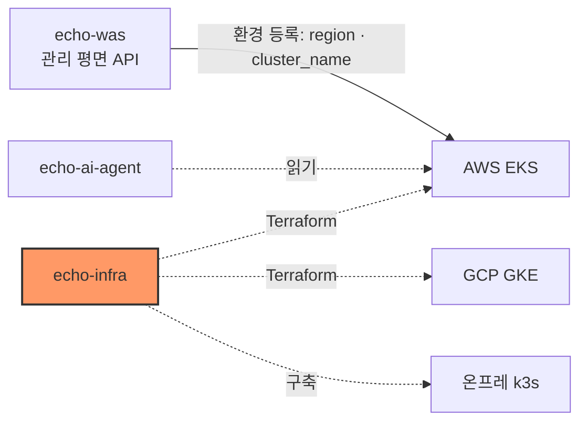

# echo-infra — 인프라·이전 엔진

인프라·이전 엔진 — EKS·GKE·온프레 k3s, Terraform·Argo CD, 트래픽 전환·데이터 동기화·롤백.

## 시스템 내 위치



## 구성

| 구성 | 위치 | 상태 |
|---|---|---|
| AWS state 버킷 | `terraform/bootstrap/aws` | 코드 있음, 미적용 |
| AWS 환경 (VPC·EKS·ECR·Budgets·CI 역할) | `terraform/environments/aws/dev` | SPEC 작성 중 ([infra-1](specs/infra-1-aws-foundation.md)) |
| GCP 환경 | — | GCP 담당 |
| 온프레 k3s | — | 이슈 #2 |
| 이전 엔진 (프록시·복제·롤백) | — | 이슈 #5~#8 |

## 핵심 흐름

1. 관리자가 `terraform/bootstrap/aws` 를 1회 적용해 state 버킷을 만든다.
2. `make up` 으로 AWS 환경을 세운다(예정).
3. 출력값 `region`·`eks_cluster_name` 으로 echo-was 에 `aws` 환경을 등록한다.

## 기술 스택

Terraform 1.16.4 · AWS provider ~> 6.67.0 · tflint 0.64.0 · AWS CLI v2

## 디렉터리 구조

```text
terraform/{bootstrap,environments,modules}/
contracts/      # 다른 파트와의 출력값 계약
specs/          # 작업 SPEC
scripts/        # check.sh
docs/           # references.md
```

## 빠른 시작

```bash
# 도구: terraform 1.16.4, tflint, AWS CLI v2
aws configure --profile echo          # 본선 계정 키 (본인 터미널에서)
export AWS_PROFILE=echo
aws sts get-caller-identity           # 계정 706878591119 확인

bash scripts/check.sh                 # fmt · validate · tflint

# state 버킷 (관리자 1회)
terraform -chdir=terraform/bootstrap/aws init
terraform -chdir=terraform/bootstrap/aws plan
```

## 인터페이스 요약

출력값 이름은 [contracts/aws-outputs.md](contracts/aws-outputs.md) 가 단일 출처다.

## 배포

`apply` 는 plan 을 사람이 확인한 뒤에만 한다. CI 자동 적용은 아직 없다.

## 현재 상태와 한계

- AWS bootstrap 코드만 있고 아직 적용하지 않았다.
- AWS 환경·GCP·온프레·이전 엔진은 아직 없다.

## 문서

| 문서 | 내용 |
|---|---|
| [CLAUDE.md](CLAUDE.md) | 규칙 문서 표·구조·원칙·도구 |
| [specs/infra-1-aws-foundation.md](specs/infra-1-aws-foundation.md) | AWS 기반 SPEC |
| [contracts/aws-outputs.md](contracts/aws-outputs.md) | 출력값 계약 |
| [docs/references.md](docs/references.md) | 참고·가져온 코드 기록 |
