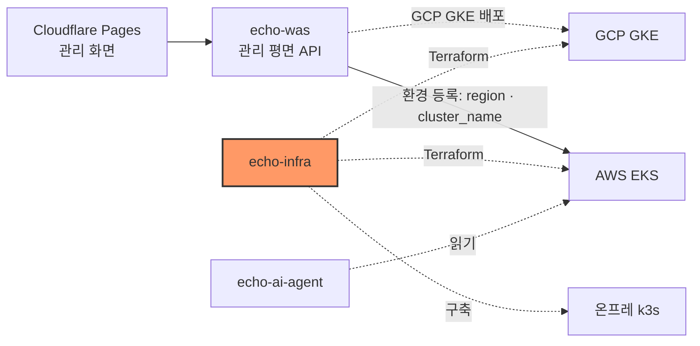

# echo-infra — 인프라·이전 엔진

인프라·이전 엔진 — EKS·GKE·온프레 k3s, Terraform·Argo CD, 트래픽 전환·데이터 동기화·롤백.

## 시스템 내 위치



## 구성

| 구성 | 위치 | 상태 |
|---|---|---|
| AWS state 버킷 | `terraform/bootstrap/aws` | 적용 (11/2) |
| AWS 환경 (VPC·EKS·ECR·Budgets·CI 역할) | `terraform/environments/aws/dev` | 적용 (11/2, [infra-1](specs/infra-1-aws-foundation.md)) |
| GCP state 버킷 | `terraform/bootstrap/gcp` | 적용 (11/2) |
| GCP 환경 (VPC·NAT·GKE·Artifact Registry·Budgets·CI 연합) | `terraform/environments/gcp/dev` | 적용 (11/2, [infra-1-gcp](specs/infra-1-gcp-foundation.md)) |
| 실행기 자격 증명 (빌드: OIDC·WIF, 배포: GSA → GKE·EKS) | `aws/dev/ci.tf`, `gcp/dev/ci.tf`, [contracts/executor-credentials.md](contracts/executor-credentials.md) | 코드 있음, plan 확인 (이슈 #3) |
| 고정 진입점 Envoy + 관측(Prometheus·Grafana) | `entrypoint/`, `terraform/environments/gcp/dev/entrypoint.tf` | 코드 있음, 로컬 e2e 통과 (이슈 #5·#9) |
| GCP 관제탑 기반 (echo-was GSA·비밀·IP·TLS) | `terraform/environments/gcp/dev/control-plane.tf` | 코드·plan 완료, apply 전 ([infra-15](specs/infra-15-gcp-control-plane-foundation.md)) |
| 온프레 k3s | — | 이슈 #2 (11/2 회의: 일단 범위 밖) |
| 이전 엔진 (프록시·복제·롤백) | — | 이슈 #5~#8 |

## 핵심 흐름

1. 관리자가 `terraform/bootstrap/aws` 를 1회 적용해 state 버킷을 만든다.
2. `make up` 으로 AWS 환경을, `make up CLOUD=gcp` 로 GCP 환경을 세운다.
3. 출력값 `region`·`eks_cluster_name`(AWS), `project_id`·`region`·`gke_cluster_name`(GCP) 으로 echo-was 에 `aws-tokyo`·`gcp-seoul` 환경을 등록한다.
4. 관제탑 출력값으로 echo-was를 GCP 서울에 배포하고 `api.echoport.uk`를 GKE Ingress에 연결한다.

## 기술 스택

Terraform 1.16.4 · AWS provider ~> 6.67.0 · Google provider ~> 8.9.0 · tflint 0.64.0 · AWS CLI v2 · gcloud

## 디렉터리 구조

```text
terraform/{bootstrap,environments,modules}/
entrypoint/     # 고정 진입점 Envoy·가중치 API·관측 스택 (VM 에 그대로 올라간다)
contracts/      # 다른 파트와의 출력값 계약
specs/          # 작업 SPEC
scripts/        # check.sh
docs/           # references.md
```

## 빠른 시작

```bash
# 도구: terraform 1.16.4, tflint, AWS CLI v2
aws configure --profile echo          # 본선 계정 키 (본인 터미널에서)
export AWS_PROFILE=echo
aws sts get-caller-identity           # 계정 706878591119 확인

gcloud auth login                     # 본선 GCP 프로젝트가 있는 구글 계정
gcloud auth application-default login # Terraform 이 쓰는 ADC
gcloud config set project <gcp-project-id>

bash scripts/check.sh                 # fmt · validate · tflint

# state 버킷 (관리자 1회)
terraform -chdir=terraform/bootstrap/aws init
terraform -chdir=terraform/bootstrap/aws plan
```

## 인터페이스 요약

출력값 이름은 [contracts/aws-outputs.md](contracts/aws-outputs.md)와 [contracts/gcp-outputs.md](contracts/gcp-outputs.md)가 단일 출처다. 관제탑은 `control_plane_ip`·`control_plane_certificate_name`·`control_plane_service_account`·`control_plane_secret_ids`를 API 담당에게 넘긴다.

## 배포

`apply` 는 plan 을 사람이 확인한 뒤에만 한다. CI 자동 적용은 아직 없다.

## 현재 상태와 한계

- AWS 도쿄 Primary와 GCP 서울 GKE·고정 진입점은 적용됐다.
- echo-was는 아직 AWS 도쿄 EKS에서 실행 중이다. GCP 관제탑 기반을 apply하고 API 담당이 앱·관리용 DB를 옮겨야 재난 영향권에서 분리된다.
- 온프레 k3s와 데이터 복제·롤백은 아직 없다.

## 문서

| 문서 | 내용 |
|---|---|
| [CLAUDE.md](CLAUDE.md) | 규칙 문서 표·구조·원칙·도구 |
| [specs/infra-1-aws-foundation.md](specs/infra-1-aws-foundation.md) | AWS 기반 SPEC |
| [specs/infra-15-gcp-control-plane-foundation.md](specs/infra-15-gcp-control-plane-foundation.md) | GCP 관제탑 기반 SPEC |
| [contracts/aws-outputs.md](contracts/aws-outputs.md)·[contracts/gcp-outputs.md](contracts/gcp-outputs.md) | 출력값 계약 |
| [docs/references.md](docs/references.md) | 참고·가져온 코드 기록 |
