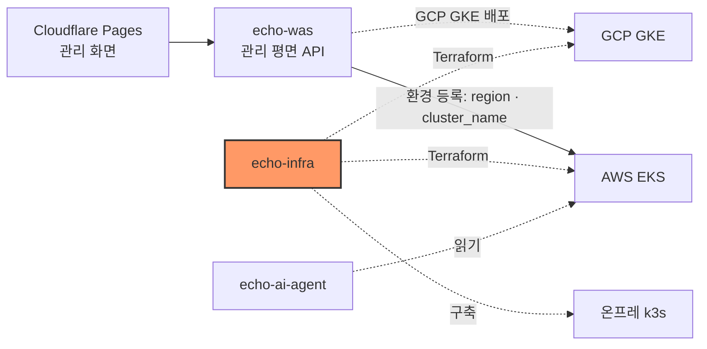

# echo-infra — 인프라·이전 엔진

인프라·이전 엔진 — EKS·GKE·온프레 k3s, Terraform·Argo CD, 트래픽 전환·데이터 동기화·롤백.

## 시스템 내 위치



## 구성

| 구성 | 위치 | 상태 |
|---|---|---|
| AWS state 버킷 | `terraform/bootstrap/aws` | 적용 (11/2) |
| AWS 환경 (VPC·EKS·ECR·Budgets·CI 역할) | `terraform/environments/aws/dev` | 적용 (11/2, [infra-1](specs/infra-1-aws-foundation.md)) |
| GCP state 버킷 | `terraform/bootstrap/gcp` | 적용 (11/2) |
| GCP 환경 (VPC·NAT·GKE·Artifact Registry·Budgets·CI 연합) | `terraform/environments/gcp/dev` | 적용 (11/2, [infra-1-gcp](specs/infra-1-gcp-foundation.md)) |
| 실행기 자격 증명 (빌드: OIDC·WIF, 배포: GSA → GKE·EKS) | `aws/dev/ci.tf`, `gcp/dev/ci.tf`, [contracts/executor-credentials.md](contracts/executor-credentials.md) | 코드 있음, plan 확인 (이슈 #3) |
| 고정 진입점 Envoy + 관측(Prometheus·Grafana) | `entrypoint/`, `terraform/environments/gcp/dev/entrypoint.tf` | 코드 있음, 로컬 e2e 통과 (이슈 #5·#9) |
| GCP 관제탑 기반 (echo-was GSA·비밀·IP·TLS) | `terraform/environments/gcp/dev/control-plane.tf` | 코드·plan 완료, apply 전 ([infra-15](specs/infra-15-gcp-control-plane-foundation.md)) |
| 온프레 k3s (어느 리눅스 기기든 같은 설치 + Cloudflare Tunnel) | `onprem/`, `terraform/environments/aws/onprem-demo` | 적용 (11/3, 시연 기기 AWS 서울 EC2, [infra-2](specs/infra-2-onprem-k3s.md)) |
| 관리 대상 앱 EKS·GKE 배치 → 진입점 업스트림 | `demo-app/` | 적용 (11/3, GKE 내부 LB 10.60.0.7 · EKS NLB, DB 는 환경별) |
| AI 에이전트 샌드박스 (운영과 연결 없는 새 VPC + VM 1대, 역할 0개 SA) | `terraform/environments/gcp/ai-sandbox` | 코드 있음, plan·apply 전 ([ai-sandbox-network](specs/ai-sandbox-network.md)) |
| 이전 엔진 — 복제·컷오버·롤백 (#7·#8) | `replication/` (로컬 PoC) · `replication/k8s/aws-tokyo/` (도쿄 A 매니페스트) | 로컬 PoC 검증(누락0·중복0, 쓰기정지 ≈0.3s·복귀 ≈0.46s) + 도쿄 A 1차안(apply 전) |

## 핵심 흐름

1. 관리자가 `terraform/bootstrap/aws` 를 1회 적용해 state 버킷을 만든다.
2. `make up` 으로 AWS 환경을, `make up CLOUD=gcp` 로 GCP 환경을 세운다.
3. 출력값 `region`·`eks_cluster_name`(AWS), `project_id`·`region`·`gke_cluster_name`(GCP) 으로 echo-was 에 `aws-tokyo`·`gcp-seoul` 환경을 등록한다.
4. 관제탑 출력값으로 echo-was를 GCP 서울에 배포하고 `api.echoport.uk`를 GKE Ingress에 연결한다.

## 기술 스택

Terraform 1.16.4 · AWS provider ~> 6.67.0 · Google provider ~> 8.9.0 · tflint 0.64.0 · AWS CLI v2 · gcloud

## 디렉터리 구조

```text
terraform/{bootstrap,environments,modules}/
entrypoint/     # 고정 진입점 Envoy·가중치 API·관측 스택 (VM 에 그대로 올라간다)
demo-app/       # 관리 대상 앱(echo-demo-app)을 EKS·GKE 에 올리는 kustomize (진입점 업스트림 주소를 만든다)
replication/    # 이전 엔진 — 논리 복제·컷오버·롤백 PoC(docker) + 도쿄 A 실배포 매니페스트(k8s/aws-tokyo/)
contracts/      # 다른 파트와의 출력값 계약
specs/          # 작업 SPEC
scripts/        # check.sh
docs/           # references.md · adr/ · design/
```

## 빠른 시작

```bash
# 도구: terraform 1.16.4, tflint, AWS CLI v2
aws configure --profile echo          # 본선 계정 키 (본인 터미널에서)
export AWS_PROFILE=echo
aws sts get-caller-identity           # 계정 <ACCOUNT_ID> 확인

gcloud auth login                     # 본선 GCP 프로젝트가 있는 구글 계정
gcloud auth application-default login # Terraform 이 쓰는 ADC
gcloud config set project <gcp-project-id>

bash scripts/check.sh                 # fmt · validate · tflint

# state 버킷 (관리자 1회)
terraform -chdir=terraform/bootstrap/aws init
terraform -chdir=terraform/bootstrap/aws plan
```

## 인터페이스 요약

출력값 이름은 [contracts/aws-outputs.md](contracts/aws-outputs.md)와 [contracts/gcp-outputs.md](contracts/gcp-outputs.md)가 단일 출처다. 관제탑은 `control_plane_ip`·`control_plane_certificate_name`·`control_plane_service_account`·`control_plane_secret_ids`를 API 담당에게 넘긴다.

## 배포

`apply` 는 plan 을 사람이 확인한 뒤에만 한다. CI 자동 적용은 아직 없다.

## 현재 상태와 한계

- AWS 도쿄 Primary와 GCP 서울 GKE·고정 진입점은 적용됐다.
- echo-was는 아직 AWS 도쿄 EKS에서 실행 중이다. GCP 관제탑 기반을 apply하고 API 담당이 앱·관리용 DB를 옮겨야 재난 영향권에서 분리된다.
- 데이터 복제·컷오버·롤백은 로컬 PoC로 **검증**했고(누락0·중복0, 쓰기정지 ≈0.3s·복귀 ≈0.46s), 도쿄 A Postgres **실배포 매니페스트 1차안**(`replication/k8s/aws-tokyo/`)까지 있다. 실제 클러스터 apply·cross-cloud 연결(TLS·서울 B)은 다음 단계다.
- 온프레 k3s는 시연 기기(AWS 서울 EC2)에 올라가 공개 주소로 열려 있다. 고정 진입점(Envoy)에는 아직 붙지 않았다(#13).

## 문서

| 문서 | 내용 |
|---|---|
| [CLAUDE.md](CLAUDE.md) | 규칙 문서 표·구조·원칙·도구 |
| [specs/infra-1-aws-foundation.md](specs/infra-1-aws-foundation.md) | AWS 기반 SPEC |
| [specs/infra-15-gcp-control-plane-foundation.md](specs/infra-15-gcp-control-plane-foundation.md) | GCP 관제탑 기반 SPEC |
| [contracts/aws-outputs.md](contracts/aws-outputs.md)·[contracts/gcp-outputs.md](contracts/gcp-outputs.md) | 출력값 계약 |
| [specs/infra-7-postgres-logical-replication-cutover.md](specs/infra-7-postgres-logical-replication-cutover.md)·[infra-8-rollback-reverse-replication.md](specs/infra-8-rollback-reverse-replication.md) | 데이터 이전(컷오버)·롤백 SPEC |
| [specs/infra-12.1-cutover-idempotent.md](specs/infra-12.1-cutover-idempotent.md) | 컷오버·롤백 스크립트 멱등화·계획 id (로컬 시험 `replication/k8s/scripts/tests/run.sh`) |
| [specs/infra-12.3-db-promote.md](specs/infra-12.3-db-promote.md) | 원본 DB 장애 시 B 승격·A 다시 맞추기 (`promote.sh`·`resync-a.sh`) |
| [specs/infra-12.2-cutover-job.md](specs/infra-12.2-cutover-job.md) · [replication/cutover-job/README.md](replication/cutover-job/README.md) | 컷오버 Job: 이미지·전용 신원·RBAC·VAP (서울 GKE `echo-ops`) |
| [replication/README.md](replication/README.md) · [replication/k8s/aws-tokyo/README.md](replication/k8s/aws-tokyo/README.md) | 이전 엔진 PoC·검증값 / 도쿄 A 실배포 매니페스트 |
| [docs/manual-resources.md](docs/manual-resources.md) | 손으로 만든 자원(Cloudflare·cert-manager·실행기 비밀)과 다시 만드는 방법 |
| [docs/references.md](docs/references.md) | 참고·가져온 코드 기록 |
