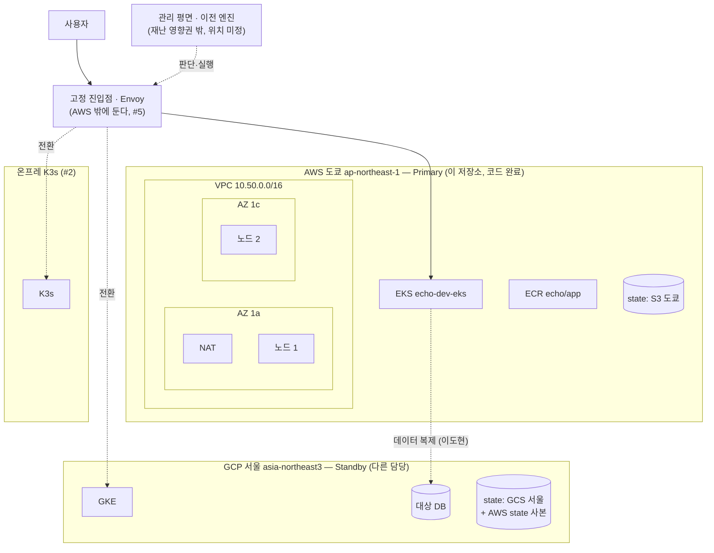

# AWS Primary 인프라 구조와 자연재해 DR 에서의 역할

- 작성: 서동옥 / 2026-11-02 / 기준 브랜치 `feat/aws-foundation` (코드 완료, apply 전)
- 시나리오(11/1 회의): **AWS 일본 리전(도쿄) → GCP 서울 리전**, 온프레 K3s 포함. 재난은 버튼으로 일으킨다.

## 1. 한 줄 요약

이 저장소가 지금 만든 AWS 인프라는 **재난을 맞는 쪽(Primary, 도쿄)** 이다. 재난을 피해 옮겨 갈 곳(GCP 서울 대기 환경), 데이터 복제, 트래픽 전환은 아직 없다. 그건 다른 이슈와 담당이 만든다. 이 문서는 "지금 만든 것이 DR 에서 어떤 자리이고, 무엇을 미리 염두에 뒀고, 무엇이 아직 비어 있는지"를 나눠 적는다.

## 2. 자연재해를 세 단계로 나눈다

| 단계 | 상황 (예) | 어디서 버티나 | 지금 상태 |
|---|---|---|---|
| L1 데이터센터 하나 손상 | 도쿄 AZ 하나가 정전·침수 | **AWS 안에서** 다른 AZ 로 버틴다 | 노드·서브넷은 AZ 2개(1a·1c)에 나눠 둠. **NAT 는 1a 하나뿐이라 약점** (§6) |
| L2 리전 전체 장애 | 대지진으로 도쿄 리전 전체가 멈춤 | **GCP 서울로 전환** (긴급 DR) | GCP 대기 환경·복제·전환 미구현 (다른 담당) |
| L3 사전 예보 | 태풍·지진 경보가 먼저 옴 | **계획된 이전**: Warm → Hot 으로 올리고 10→50→100% | 이전 엔진 미구현 (#5~#8) |

DR 데모의 중심은 L2·L3 이다. L1 은 "클라우드 하나 안에서도 기본은 한다"는 바닥이다.

## 3. 전체 구성 (목표)

## 4. 지금 만든 것과 DR 에서의 자리

| 만든 것 | 평소 역할 | DR 에서의 자리 |
|---|---|---|
| state 버킷 `echo-tfstate-…` (S3 도쿄) | Terraform 기록장 | AWS 자기 state 만 둔다. 도쿄가 죽으면 AWS 를 고칠 일이 없으니 괜찮다. Failback 재구축용 사본은 GCS 에 둘 예정 |
| VPC `10.50.0.0/16` | 네트워크 | GCP 서울·온프레와 **CIDR 이 겹치지 않아야** 복제·VPN 을 이을 수 있다. GKE·K3s 는 기본 대역을 써서 겹치지 않는다(`contracts/aws-outputs.md`) |
| 서브넷·노드 AZ 2개 | 앱 실행 | L1(AZ 하나 손상) 대비 |
| EKS 1개 + 노드 2대 | 서비스 실행 | Primary 서비스 위치. echo-was 에 `aws-tokyo` 환경으로 등록 |
| ECR (태그 불변) | 이미지 저장 | **GCP 가 ECR 에서 이미지를 받으면 안 된다.** 도쿄가 죽으면 GCP 배포도 막힌다(예선 iris-infra 가 그랬다). GCP 쪽 레지스트리로 복제가 필요 |
| `make up` / `make down` | 재구축 | Failback 때 도쿄를 다시 세우는 수단 (NFR-16, 명령 2개) |
| 비용 알림 | 비용 관리 | Warm Standby 를 고른 이유가 비용이다. 비용을 숫자로 보여 줄 근거 |
| EKS 감사 로그 | 기록 | 재난 중 누가 무엇을 바꿨는지 남긴다 (F5 감사 로그와 연결) |
| CI plan 역할 (OIDC) | 변경 검토 | 장기 키 없이 plan 만 |

## 5. DR 을 위해 미리 지킨 원칙

1. **각 클라우드의 state 는 그 클라우드에 둔다.** AWS → S3 도쿄, GCP → GCS 서울. 복구 쪽(GCP)이 AWS 에 기대지 않게 한다.
2. **복구 경로는 AWS 에 의존하지 않는다.** 전환을 판단·실행하는 관리 평면·이전 엔진·진입점은 도쿄 밖에 둔다. 이미지도 GCP 쪽에 따로 있어야 한다.
3. **환경끼리 이름·주소가 겹치지 않는다.** CIDR 비중복, 환경 이름 `aws-tokyo` / `gcp-seoul`.
4. **다시 세울 수 있어야 한다.** 손으로 만든 리소스 없이 Terraform 으로만 만든다. 재구축 명령 2개.
5. **출력값 계약을 고정한다.** 이전 담당이 받는 값(`vpc_cidr`, `eks_cluster_name` 등)은 `contracts/aws-outputs.md` 가 단일 출처.

## 6. 알려진 약점 (해커톤 범위에서 일부러 둔 것)

| 약점 | 재난 때 영향 | 운영이라면 |
|---|---|---|
| **NAT 1개 (AZ 1a)** | 1a 가 죽으면 1c 노드도 외부로 나가는 통신(이미지 pull, 외부 API)이 끊긴다. 들어오는 요청은 영향 없음 | AZ 마다 NAT. 비용 두 배 |
| EKS 1개 (관리·앱 겸용) | 클러스터 장애 = 도쿄 전체 장애로 본다 | 관리용 분리 |
| 도쿄 안 DB 없음 | 아직 이전할 데이터가 없다 | DB 위치는 이도현 님 결정 (RDS 또는 클러스터 안) |
| 백업 없음 | 논리 손상·랜섬웨어 대비 없음 | 3-2-1-1-0. 회의 결정: 모든 리전에 같은 백업 전략 |
| 관측 없음 | 전환 판정 지표가 없다 | OTel 수집기 (#9) |

## 7. 재난(L2) 때 무엇이 살아 있어야 하나

| 구성 | 도쿄 리전 장애 시 | 필요한 대책 | 담당 |
|---|---|---|---|
| 사용자 진입점 | 도쿄 안에 있으면 같이 죽는다 | 도쿄 밖 Envoy + DNS 페일오버 | #5 |
| 데이터 | 비동기 복제는 마지막 몇 초가 빠질 수 있다 (RPO > 0) | 복제 지연 측정, 손실·중복 검증 | 이도현 님 (#7·#8, #12) |
| 이미지 | ECR 도쿄를 못 쓴다 | GCP 레지스트리 사본 | 빌드·배포 (#3) |
| 관리 평면(echo-was)·대시보드 | 도쿄에 두면 재난 화면을 못 띄운다 | 도쿄 밖에서 실행 | API·프론트 |
| Terraform state | AWS state 접근 불가 | GCP 는 GCS 에 따로. AWS 사본도 GCS 에 | 인프라 |
| 비밀값 | Secrets Manager 도쿄 접근 불가 | GCP Secret Manager 에 따로 | 각 파트 |

## 8. 팀이 정할 것

1. 관리 평면·이전 엔진·진입점을 어디서 돌릴지 (도쿄 밖)
2. 예산 ₩500,000(NFR-13)을 AWS·GCP 로 나누는 방식, 알림 받을 메일
3. NAT 를 AZ 마다 둘지 (L1 데모를 할 거면 필요)
