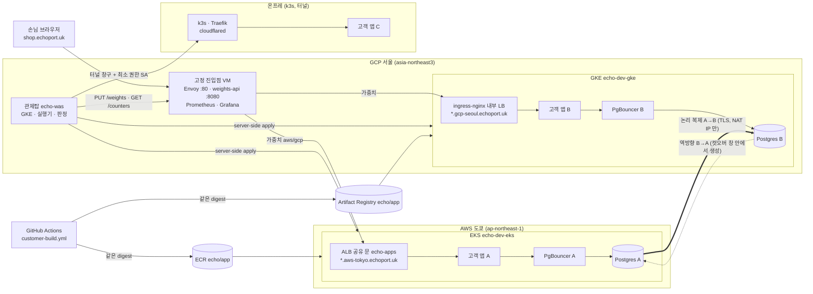

# 인프라·이전 엔진 설계 (제출 문서 인프라 절 초안, 2026-11-04 저녁 갱신)

> 11/7 제출 설계 문서(프론트 10)의 인프라 절. 원본은 이 저장소의 README·`entrypoint/README.md`·`cluster-addons/README.md`·`replication/k8s/README.md`. 숫자는 측정값만 적고, 아직 없는 값은 `TBD` 로 둔다.

## 1. 한눈에 보기



## 2. 세 환경

| 환경 | 구성 | 공개 경로 | 세우는 법 |
|---|---|---|---|
| AWS 도쿄 | EKS `echo-dev-eks`(비공개 노드, NAT 18.180.171.76), ECR `echo/app`, ALB 공유 문 `echo-dev-apps`(80·443, ACM `*.aws-tokyo.echoport.uk`) | `{서비스}-{suffix}.aws-tokyo.echoport.uk` → ALB(진입점·GKE NAT 만 허용) | `terraform/environments/aws/dev` apply 1회 + `cluster-addons/eks` |
| GCP 서울 | GKE `echo-dev-gke`(비공개 노드, NAT 34.64.211.218), Artifact Registry `echo`, ingress-nginx 내부 LB 10.60.0.8(Let's Encrypt `*.gcp-seoul.echoport.uk`) | `{서비스}-{suffix}.gcp-seoul.echoport.uk` → VPC 안에서만(일꾼 헬스체크) | `terraform/environments/gcp/dev` apply 1회 + `cluster-addons/gke` |
| 온프레 | k3s 단일 노드(어느 리눅스 기기든 `onprem/install.sh`), Traefik, cloudflared 터널(들어오는 포트 0) | `{서비스}-{suffix}.echoport.uk` CNAME → 터널 | `install.sh` 1회 |

- 두 클라우드 모두 Terraform(원격 상태), 예산 알림 80%·100%, 저장소 비밀 0건(OIDC·Workload Identity, tfvars 는 로컬).
- 같은 이미지를 ECR·AR 에 **같은 digest** 로 둔다(빌드 1회, push 2곳). 어느 환경으로 가든 digest 가 같아 "같은 것"을 옮겼다고 말할 수 있다.

## 3. 고정 진입점 (F6)

- 고객 대표 주소 `{서비스}-{suffix}.echoport.uk` 는 항상 서울 VM 의 Envoy 로 온다. 이전 중에도 주소창은 그대로다.
- **가중치**: `PUT /weights {"aws":50,"gcp":50}` → 파일 기반 xDS, 재시작 없이 즉시(로컬 측정 1초 안). 10 → 50 → 100% 단계 승격은 echo-was 가 `GET /counters`(환경별 누적 요청·5xx, Envoy 호스트 통계라 즉시)로 "도착 환경이 N건 처리"를 확인한 뒤 올린다.
- **장애**: `/healthz` 2초 간격, 2회 실패면 제외. aggregate 클러스터(`aws_then_gcp`·`gcp_then_aws`)라 한쪽이 전멸하면 가중치와 무관하게 전부 다른 쪽으로 간다.
- **DNS 가중치를 쓰지 않는 이유**(`entrypoint/README.md`): 반영 시점이 TTL·리졸버 캐시에 묶여 비율을 알 수 없고, 요청을 세지 못해 건수 판정이 안 되며, 롤백 60초(NFR-05)를 보장 못 한다. Envoy 는 어느 클라우드에서도 같은 설정이라 벤더 중립이다.
- **단일 장애점**: 진입점 VM 한 대. 대응은 진입점 두 곳 + DNS 페일오버 PoC(인프라 5.1, `TBD`). DNS 는 프록시 자체의 생존에만 쓴다.

## 4. 빌드·배포 경로 (F1)

1. echo-was 가 `customer-build.yml`(echo-was 저장소) 을 `workflow_dispatch` 로 띄운다(입력: build_id·repo·commit_sha·private). 비공개 저장소는 워크플로 안에서 GitHub App 토큰을 받는다.
2. 빌드 1회 → ECR·AR 에 같은 digest·태그 `b-<build_id 12자>` → 아티팩트 `build-result.json`(digest, 두 저장소 주소).
3. echo-was 실제 실행기가 대상 클러스터에 **server-side apply**: 네임스페이스 `{서비스}-{suffix}`(라벨 `app.kubernetes.io/managed-by=echo-was`), Deployment·Service·Ingress. 접속은 GKE(메타데이터 토큰), EKS(Google ID 토큰 → STS, 역할 `echo-dev-executor`), 온프레(터널 창구 + 전용 SA, ValidatingAdmissionPolicy 로 라벨 네임스페이스 밖은 거부).
4. 환경별 주소 헬스체크(https)를 통과해야 교체. 대표 주소는 진입점이 가중치로 나눈다.
5. 공유 문: 앱마다 LB 를 만들지 않고 환경마다 하나(ALB 그룹 `echo-apps` 닻 Ingress, ingress-nginx). 앱 Ingress 는 규칙만 더한다. Argo CD 는 2차.

## 5. 데이터 복제·컷오버·롤백 (F8·F9)

```text
AWS 앱 ──▶ A PgBouncer ──┐                       ┌── B PgBouncer ◀── GCP 앱
                        ├─▶ A Postgres ══복제══▶ B Postgres ◀┘  (컷오버 전: 두 PgBouncer 모두 A 를 본다)
                        │   (NLB, GCP NAT 만)      (LB, AWS NAT 만)
컷오버 = 두 PgBouncer PAUSE → B 따라잡음(replay_lag 0) → 시퀀스 맞춤 → 역방향 구독(B→A) → 백엔드를 B 로 → RESUME
```

- 앱은 **자기 쪽 PgBouncer 로만** 붙는다. 컷오버는 접속 문자열이 아니라 PgBouncer 백엔드 전환이다(쓰기 정지 목표 ≈ 1초, 11/4 리허설 실측 7.97초 — 7절·10절).
- 역방향 구독은 **쓰기 정지 창 안에서** `copy_data=false` 로 만들어 빈틈이 없다. 롤백은 거울(`rollback.sh`).
- cross-cloud 는 공개 LB 지만 상대 클라우드 NAT IP 만 받고 scram + TLS.
- 대조: 순번 쓰기 N건 → 누락 0·중복 0 (`verify.sh`). 재난(A 급사)은 롤백이 아니라 승격(B 구독 DISABLE → B 백엔드를 B 로).
- **시연 순서**(11/4 합동 리허설로 확정): Echo 이전(앱, 10→50→100%) → DB 컷오버 A→B → Echo 복귀 → DB 롤백 B→A. 이전 도중 컷오버하면 쓰기 정지 8초가 오류율 롤백을 부르고, 복귀의 데이터 확인은 역방향 구독(`echo_sub_rev`)이 있어야 통과하므로 컷오버가 복귀보다 앞선다.
- 스크립트: `replication/k8s/scripts/{subscribe,lag,cutover,rollback,verify,writer,rehearsal}.sh`. 리허설 1회가 `rehearsals/<시각>.md` 표를 남긴다.
- **11/4 실배선 상태**: A(도쿄) Postgres 17 `ssl=on`·`wal_level=logical`·발행 `echo_pub`, NLB `echo-dev-pg-a-….elb.ap-northeast-1.amazonaws.com:5432`(GCP NAT 34.64.211.218/32 만, 자체 서명 `CN=echo-pg-a`, `sslmode=require`). B(서울) 같은 구성, LB `34.22.85.222:5432`(AWS NAT 18.180.171.76/32 만). B 구독 `echo_sub` 생성 → A 에서 `streaming`, `demo.seq_write` 동기 상태 ready. 두 PgBouncer 백엔드는 모두 A(B 는 라이브 ini 와 ConfigMap 둘 다 A 로 맞춤). 계정은 양쪽 동일(`app_rw`·`repl_user`·`pgbouncer_auth`·`echo_monitor`).
- **복제 지연 판정 연결**: echo-was `PostgresDataSyncChecker`(DATA_SYNC_CHECK) 가 발행 쪽 `pg_stat_replication.replay_lag` 를 `echo_monitor`(pg_monitor, 읽기 전용) 계정으로 읽는다. 비밀번호는 GCP Secret Manager `echo-dev-echo-was-pg-monitor-password` 에만(껍데기 Terraform, 값은 `monitor-user.sh`).

## 6. 측정·관측 (F17)

| 무엇 | 어디서 |
|---|---|
| 환경별 요청 수·5xx (판정 근거) | 진입점 `GET /counters` (Envoy 호스트 통계, 즉시) |
| rps·5xx 비율·p95·healthy | 진입점 `GET /summary`(Prometheus 5초 간격) · Grafana 「Echo 고정 진입점」 |
| 이전 단계별 시각·판정·롤백 | echo-was 이전 실행 로그(`PLAN_CREATED … WEIGHT_APPLIED JUDGE_PASSED … SUCCEEDED`) |
| 쓰기 정지·복제 지연·누락/중복 | `rehearsal.sh` → `replication/k8s/rehearsals/<시각>.md` |
| 복제 지연 (이전 중 DATA_SYNC_CHECK 판정) | A/B `pg_stat_replication.replay_lag`(계정 `echo_monitor`), echo-was `DATA_SYNC_CHECKER_MODE=postgres` |
| 합성 트래픽 | `entrypoint/loadgen`(k6, GKE 에서 진입점 공인 주소로 초당 50건, 시연 때만 켬) |

## 7. 측정값 (실측만)

| 항목 | 값 | 출처 |
|---|---|---|
| 운영 이전 aws→gcp (10→50→100%) | 9.1초, 5xx 0 | 11/3 22:37 지민, echo-was #8 |
| 실패 주입 → 자동 롤백 | 1.5초, `THRESHOLD_EXCEEDED` → `ROLLED_BACK` | 같음 |
| 복귀 gcp→aws | 10.4초, p95 ≈ 96ms | 같음 |
| **실제 실행기** 이전 aws→gcp (대시보드, 50 rps 부하) | 9초, 실패 요청 0 | 11/4 12:27~12:37 지민, echo-frontend #51 |
| 실제 실행기 복귀 gcp→aws (Start failback) | 13초, 실패 요청 0 | 같음 |
| 실제 실행기 이전 중 Roll back | 되돌림 3초 | 같음 |
| 장애 시 우회 | 1초 안 (로컬) | `entrypoint/README.md` |
| 컷오버 A→B 쓰기 정지 / 롤백 B→A 복귀 | 7.97초 / 9.42초 (PAUSE 드레인 ≈1초 + 따라잡기 <1초 + 역방향 구독·repoint·RESUME ≈6~8초) | 11/4 20:25 10 rps 쓰기 중, `rehearsals/2026-11-04-2025.md` |
| 컷오버·롤백 대조 | A 168 = B 168, 누락 0 · 중복 0 | 같음 |
| 컷오버·롤백 중 쓰기 요청 | 166건 중 5건 클라이언트 10초 타임아웃, 데이터 누락 0(4건은 DB 반영) | 같음 |
| **합동 시연 순서** Echo 이전 → DB 컷오버 → Echo 복귀 → DB 롤백 | 이전 10초(복제 지연 0 통과) → 컷오버 쓰기 정지 8.5초 → 복귀 9초(역방향 지연 0 통과, 5xx 증가 0) → 롤백 9.8초, 대조 168=168 | 11/4 21:10~21:16 `rehearsals/2026-11-04-2110-joint.md` |

## 8. 보안·권한 (인프라 몫)

- 장기 키 없음: GitHub Actions 는 OIDC(AWS 역할 `echo-dev-ci-build`, GCP WIF), 실행기는 관제탑 GSA 의 Google ID 토큰 → AWS STS. 비밀은 Secret Manager 참조.
- 공개 경로 최소: 진입점 80 만 공개, ALB 는 진입점·GKE NAT 두 IP, nginx 는 내부 LB, DB cross-cloud 는 상대 NAT IP 만 + TLS, GKE·EKS 노드 비공개, 온프레 들어오는 포트 0(터널).
- 온프레 실행기: 전용 SA + ClusterRole 최소 권한(네임스페이스 get·list·create·delete, 노드 get·list — 11/4 환경 카드 노드 수용 추가, RoleBinding get·create, `echo-app-deployer` bind) + ValidatingAdmissionPolicy(라벨 `managed-by=echo-was` 네임스페이스 밖은 거부).
- DB 계정 분리: `app_rw`(앱 쓰기)·`repl_user`(복제 전용, REPLICATION)·`pgbouncer_auth`(auth_query 만)·`echo_monitor`(pg_monitor 읽기 전용). 비밀번호는 k8s Secret `echo-pg-secret`·GCP Secret Manager 에만, 저장소·이슈·Slack 에 0건.
- 손으로 만든 자원은 Terraform 으로 옮기거나 목록으로 남긴다(`docs/manual-resources.md`, 인프라 3.3): 실행기 비밀 껍데기 3개는 Terraform(import 뒤 No changes), Cloudflare 레코드·규칙과 cert-manager 는 문서.
- AI 에이전트 샌드박스(형래, PR #50): 같은 프로젝트의 **별도 VPC**(피어링 없음) + VM 1대, 공인 IP 없음, 인바운드 IAP 22 만, 아웃바운드 443 만, VM SA 프로젝트 역할 0개. plan 16 add/0 change/0 destroy 확인, apply 11/5.
- 후속(보안·거버넌스 7~10, 형래): 자동 전환 목적지 자격, DB 쓰기 소유권 fencing, 네트워크 허용표, 신원 분리.

## 9. 재구축·비용

- 환경 하나 = `terraform apply`(클라우드) + `cluster-addons`(공유 문) 또는 `install.sh`(온프레).
- **재구축 리허설(11/5 01:00, 인프라 11)**: 같은 코드로 AWS 환경을 옆에 새로 세움 — `terraform apply` 46개 10분 56초(EKS 컨트롤 플레인 8분 16초) + 공유 문 2분 7초 = **13분 3초**, 실패 0, dev 변경 0. ACM 인증서는 같은 검증 CNAME 으로 자동 발급. 기록 `docs/rehearsals/2026-11-05-rebuild-aws.md`.
- 실제 dev 를 부수고 다시 세울 때는 위 2개 명령 밖에 재연결 5단계가 더 있다(Cloudflare `*.aws-tokyo` CNAME, 진입점 upstream tfvars, A DB 재생성, `subscribe.sh`, echo-was 환경 재확인). 같은 기록의 발견 표.
- 예산 알림 두 클라우드 80%·100%. 노드는 작은 타입(e2-standard-2 등), 진입점은 e2-small.

## 10. 알려진 한계와 대안

| 한계 | 지금 | 대안·계획 |
|---|---|---|
| 진입점 단일 장애점 | VM 1대 → 11/4 보조 VM(존 b) 적용, Cloudflare 두 번째 A 레코드·측정 대기 | 두 곳 + DNS 페일오버 PoC(5.1), 규모가 커지면 관리형 LB 뒤 Envoy 여러 대 |
| 같은 계정에 두 번째 AWS 환경 | OIDC 공급자(계정당 1개)·ECR 이름(`echo/app`)·닻 ALB 이름이 환경 무관 | 리허설은 `-target`·`project` 변수로 우회. 후속: OIDC data 참조 옵션, ECR·ALB 이름을 환경에서 파생 |
| 첫 이전 때 도착 환경 p95 `null` | Prometheus `usedonly` 수집 | 판정엔 영향 없음(건수 기반). 수집 옵션 조정 또는 사전 워밍 |
| 클러스터 공통 OTel 수집기 | 진입점 Prometheus 만 | 인프라 9, DR 적용 뒤 |
| 온프레가 진입점 업스트림에 아직 없음 | aws·gcp 2개 | `UPSTREAMS` 한 줄(인프라 13 선행) |
| 쓰기 정지 8초(목표 1초) | 창 안에서 역방향 구독 생성 + kubectl exec 왕복 6~7회 | 역방향 구독을 미리 `enabled=false` 로 두고 창 안에서 ENABLE 만, repoint 병렬, 클러스터 안(Job)에서 실행 |
| 컷오버 실행이 이전 계획과 분리 | 사람이 `cutover.sh` | echo-was 는 복제 지연만 확인(DATA_SYNC_CHECK). 비율 100% 뒤 컷오버 호출은 후속 |
| PgBouncer repoint 가 파드 emptyDir 에만 남음 | 파드 재시작 시 ConfigMap 값으로 복귀 | `cutover.sh`·`rollback.sh` 가 ConfigMap 도 함께 갱신(후속, 지민). B 는 11/4 ConfigMap 을 A 로 맞춰 둠 |
| A PgBouncer → B 연결(컷오버 뒤)이 평문 | A ini 에 `server_tls_sslmode` 없음 | `server_tls_sslmode = require` 한 줄 추가(#45 요청) |
