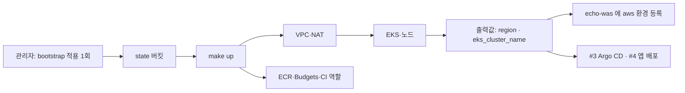

# 인프라·이전 엔진 1 (AWS 절반): 계정·비용 알림 + Terraform 기반 SPEC

- 상태: Draft (팀 검토 전)
- 확인일: 2026-11-02
- 노션 태스크: https://app.notion.com/p/756362460333470dbd1d5e4980201aba
- GitHub 이슈: echo-infra #1 `[인프라·이전 엔진 1] 클라우드 계정 · 비용 알림 + Terraform (EKS·GKE)`. 이 SPEC 은 **AWS 절반**이다. GKE 절반은 GCP 담당이 따로 쓴다.
- 저장소: `echo-infra` · 브랜치 `feat/aws-foundation`
- 작성: 서동옥

## 1. 목표

AWS 에 서비스가 처음 도는 환경(EKS 클러스터 하나)을 Terraform 으로 세운다. 비용 알림을 걸고(NFR-13), 저장소에 비밀값을 남기지 않는다(NFR-17). echo-was 가 이 클러스터를 `aws` 환경으로 등록할 수 있게 `region`·`cluster_name` 을 출력값으로 넘긴다(F2). 다른 파트(앱·이전 엔진·AI)가 이 위에 올라탈 수 있도록 출력값 이름을 고정한다.

## 2. 현재 맥락과 확인된 사실

- 저장소: `README.md` 한 줄(초기 커밋 `481cbf3`). 팀 틀은 echo-was 를 따른다(규칙·SPEC·PR 템플릿).
- 본선 AWS 계정: `706878591119`. IAM 그룹 `echo-dev`(AdministratorAccess)에 dohyun·dongok·hyungrae·jimin. 기본 VPC(`172.31.0.0/16`)만 있다. 예산 2개가 이미 있다: `My Monthly Cost Budget`(USD 150), `My Zero-Spend Budget`(USD 1).
- echo-was 계약
  - `aws` 환경 config = `region`(`ap-northeast-2` 형식) + `cluster_name`. 어댑터는 EKS 를 전제한다(`ClusterInfo` = 쿠버네티스 `gitVersion`·`node_count`). 실제 EKS 접속 어댑터는 "인프라 파트가 클러스터를 만든 뒤 별도 작업".
  - 환경 이름은 RFC 1123 label(`aws-seoul`). 이미지는 `repo@sha256:…`, tag 금지.
  - secretRef `aws-sm:<이름|ARN>` 예약.
  - 프로브 `/healthz`·`/readyz`. 마이그레이션 실행 방식은 "인프라 파트와 정한다"(Job 1회 실행).
- 이슈 #11(재구축 리허설): 환경 하나를 명령 2개 이내로 다시 세운다(NFR-16). 이 SPEC 의 구조가 그 전제가 된다.
- 11/1 팀 회의(2부)
  - 시나리오는 **AWS 일본 리전 → GCP 서울 리전** 이전. 온프레(K3s)도 필수 범위.
  - 역할: 인프라 초기 세팅 = 서동옥, **세팅 후 월·화(11/2~3)까지 이도현 님(데이터 백업·이전)께 전달.** 보안·AI 에이전트 = 김형래.
  - 모든 리전에 같은 백업 전략(지역별 차등 없음). 테스트 필수, 자기 파트는 리뷰 없이 머지.
- 참고: 예선 `iris-infra`@`8b4e2a8` 에 같은 계열 구성(S3 state·OIDC·VPC·EKS 2개·RDS)이 있다. LICENSE 가 없어 코드는 허락 뒤에만 가져온다([docs/references.md](../docs/references.md)).

## 3. 범위

### 포함

- `terraform/bootstrap/aws`: state 버킷(버전 관리·암호화·공개 차단·TLS 강제)
- `terraform/environments/aws/dev`
  - 비용 알림(AWS Budgets)
  - VPC(2 AZ, public/private 서브넷, NAT 1개)
  - EKS 클러스터 1개 + 관리형 노드 그룹 2대
  - ECR(태그 불변)
  - GitHub OIDC 공급자 + CI 역할(이 저장소 plan 용)
- 출력값 계약 `contracts/aws-outputs.md`
- 재구축 명령 골격 `make up` / `make down`

### 제외 (다른 이슈·담당)

- GKE·온프레 k3s (이슈 #1 GCP 절반, #2)
- Argo CD·빌드 파이프라인 (#3)
- 관리 대상 앱과 PostgreSQL 위치 (#4). **DB 를 RDS 로 할지 클러스터 안에 둘지는 데이터 백업·이전 담당(이도현)이 정한다.** RDS 로 정해지면 RDS 와 논리 복제 파라미터는 이 저장소에 별도 이슈로 더한다.
- Envoy 프록시·트래픽 전환·복제·롤백 (#5~#8)
- OTel 수집기 (#9)
- AI 샌드박스 네임스페이스·권한 (echo-ai-agent #2·#3 에서 요청이 오면 별도 이슈)

## 4. 구성 요소

| 구성 요소 | 위치 | 설명 |
|---|---|---|
| state 버킷 | `terraform/bootstrap/aws` | `echo-tfstate-<account_id>`. 다른 루트는 `use_lockfile` 로 잠금 |
| 비용 알림 | `environments/aws/dev/budget.tf` | 월 비용 알림. 받는 메일은 변수 |
| 네트워크 | `environments/aws/dev/network.tf` | VPC `10.50.0.0/16`(GCP 서울·온프레 K3s CIDR 과 겹치지 않게 이도현 님과 확인), AZ `1a`·`1c` |
| EKS | `environments/aws/dev/eks.tf` | 클러스터 1개, 노드 2대, API 공개 엔드포인트 + 허용 CIDR, 인증 모드 API(Access Entry) |
| ECR | `environments/aws/dev/ecr.tf` | `IMMUTABLE` 태그, 푸시 시 스캔 |
| CI 역할 | `environments/aws/dev/ci.tf` | GitHub OIDC, 이 저장소 `main`·PR 에서 plan |
| 재구축 | `Makefile` | `make up`(bootstrap 확인 → init → apply), `make down`(destroy) |

## 5. 흐름

## 6. 기능 요구사항

- FR-1 bootstrap 은 로컬 state 로 1회 적용하고, 버킷 이름을 출력한다.
- FR-2 `environments/aws/dev` 는 S3 backend(`use_lockfile = true`)를 쓴다. 실제 `backend.hcl` 은 커밋하지 않고 `.example` 만 둔다.
- FR-3 비용 알림을 Terraform 으로 만든다. 금액은 변수로 둔다(§13 결정 1).
- FR-4 모든 리소스에 `project`·`env`·`managed-by`·`repo` 태그가 붙는다(provider `default_tags`).
- FR-5 EKS 는 Access Entry 로 팀원 IAM 사용자에게 관리자 접근을 준다. 목록은 변수.
- FR-6 출력값 `region`·`eks_cluster_name`·`eks_cluster_endpoint`·`vpc_id`·`vpc_cidr`·`private_subnet_ids`·`ecr_repository_urls` 를 낸다.
- FR-7 `make up`·`make down` 두 명령으로 환경을 세우고 지운다(state 버킷 제외).
- FR-8 `scripts/check.sh` 가 통과해야 커밋된다(훅).

## 7. 상태와 예외

| 상황 | 처리 |
|---|---|
| state 버킷 없음 | `make up` 이 멈추고 bootstrap 적용 안내 |
| 서비스 쿼터 부족(EKS 노드·EIP) | apply 전 `scripts/preflight.sh` 로 확인, 부족하면 증설 요청 |
| 남은 리소스로 `make down` 실패(ALB·ENI 가 다른 파트 것) | 다른 파트 리소스를 먼저 지우는 순서를 runbook 에 적는다 |
| 비용 알림 초과 | 메일 수신 → 팀 채널 공유 → 노드 수 축소 또는 `make down` |

## 8. 데이터 계약

[contracts/aws-outputs.md](../contracts/aws-outputs.md) 가 출력값 이름의 단일 출처다. 이름을 바꾸면 PR 체크리스트에 적는다.

| 출력값 | 받는 쪽 | 예 |
|---|---|---|
| `region` | echo-was `AwsEnvironmentConfig.region` | `ap-northeast-1` |
| `eks_cluster_name` | echo-was `AwsEnvironmentConfig.cluster_name`, #3 Argo CD | `echo-dev-eks` |
| `eks_cluster_endpoint` | #3, AI 에이전트(읽기) | `https://…eks.amazonaws.com` |
| `vpc_id`·`vpc_cidr`·`private_subnet_ids` | #4(DB 위치 결정 시), #5·#7(복제·VPN) | `10.50.0.0/16` |
| `ecr_repository_urls` | #3 빌드·배포, #4 앱 | `…dkr.ecr.ap-northeast-1.amazonaws.com/echo/app` |

## 9. 호환성·배포·복구

- 적용 순서: bootstrap(1회) → `make up`. 되돌리기는 `make down`(state 버킷과 그 안의 state 는 남긴다).
- EKS 버전과 노드 AMI 는 변수로 고정하고, 본선 기간에는 올리지 않는다.
- VPC CIDR 은 바꾸면 전체 재생성이라 첫 적용 전에 GCP 담당과 확정한다.

## 10. Acceptance criteria

- [ ] AC-1 `terraform/bootstrap/aws` 적용 후 state 버킷이 버전 관리·암호화·공개 차단 상태다.
- [ ] AC-2 `make up` 한 번으로 VPC·EKS·ECR·Budgets·CI 역할이 생기고, `kubectl get nodes` 에 노드 2대가 `Ready` 다.
- [ ] AC-3 echo-was 에 `region`·`eks_cluster_name` 으로 `aws` 환경을 등록할 수 있다(실제 어댑터가 생긴 뒤 확인).
- [ ] AC-4 비용 알림이 콘솔 Budgets 에 보이고 받는 메일이 팀 주소다.
- [ ] AC-5 `git grep` 으로 비밀값·계정 키 0건, `.tfvars`·`backend.hcl` 미커밋(NFR-17).
- [ ] AC-6 `make down` → `make up` 으로 다시 세워진다(이슈 #11 리허설의 AWS 몫).
- [ ] AC-7 `scripts/check.sh` 통과.

## 11. 핵심 엔티티

| 엔티티 | 식별자 |
|---|---|
| state 버킷 | `echo-tfstate-<account_id>` |
| EKS 클러스터 | `echo-dev-eks` |
| echo-was 환경 이름 | `aws-tokyo` |
| ECR 저장소 | `echo/<service>` |

## 12. 리스크 (사전 부검)

| 실패 시나리오 | 대비 |
|---|---|
| 신규 계정 쿼터(EIP·vCPU) 때문에 노드가 안 뜬다 | 11/2 안에 쿼터 확인, 부족하면 바로 증설 요청 |
| VPC CIDR 이 GCP 쪽과 겹쳐 VPN 이 안 된다 | 첫 apply 전 CIDR 표 합의 |
| NAT·EKS 가 켜진 채 방치돼 비용 초과 | 비용 알림 + 본선 끝나면 `make down` |
| 다른 파트가 만든 ALB·ENI 때문에 destroy 가 막힌다 | 철거 순서 runbook |
| 관리자 키 유출 | 장기 키는 사람 1인 1개, CI 는 OIDC. 유출 시 즉시 비활성화 |

## 13. 결정 기록

1. **비용 알림 금액 (열림)**: NFR-13 은 ₩500,000. AWS Budgets 는 USD 로 만든다. 두 클라우드 합계인지, AWS 몫을 얼마로 나눌지 팀이 정한다. 기존 USD 150 예산과 겹치지 않게 Terraform 것 하나로 합칠지도 정한다.
2. **EKS 1개 (제안)**: 예선 iris-infra 는 관리용·앱용 2개였다. 해커톤 기간 비용과 구축 시간 때문에 1개로 한다. 버린 이유: 권한 격리 이점이 본선 범위에서 비용보다 작다.
3. **NAT 1개 (제안)**: AZ 마다 1개면 AZ 장애에 강하지만 비용이 두 배다. 본선 기간에는 1개.
4. **EKS API 공개 엔드포인트 + 허용 CIDR (제안)**: private + SSM 터널(iris-infra)은 안전하지만 5명이 붙기까지 시간이 든다.
5. **리전 `ap-northeast-1` 도쿄 (일본 리전은 11/1 회의 확정, 도쿄는 제안)**: 시나리오가 "AWS 일본 리전 → GCP 서울"이다. 오사카(`ap-northeast-3`)보다 서비스·쿼터 선택지가 넓다.

## 14. 구현에 위임한 세부사항

- 노드 인스턴스 타입(쿼터·비용을 보고 정한다)
- EKS 애드온 버전
- 서브넷 세부 CIDR 분할
- `make` 대상의 출력 형식
